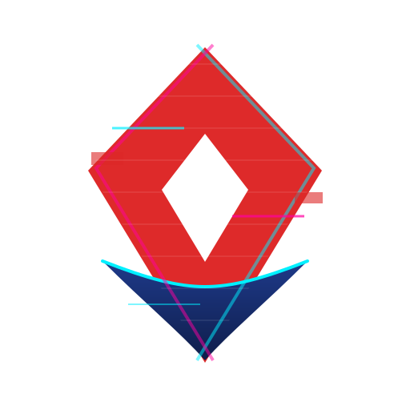

<div align="center">



# Red Queen Ark

**An AI assistant for business, family, and personal life.**

One assistant, one memory, one set of settings — in a terminal, in a browser, or on a server you host yourself.

[Documentation](https://rqark.docs.ansoncar.com) · [Introduction](https://rqark.docs.ansoncar.com/introduction/) · [Quick Start](https://rqark.docs.ansoncar.com/quick-start/)

</div>

---

## Quick start

One compose file brings up the whole stack: the data cloud, the agent cloud, the task worker, and the web console, with the two stores they need alongside them. Every image is published on GHCR, so nothing is built locally.

```bash
mkdir rqark && cd rqark
curl -fsSLO https://raw.githubusercontent.com/Red-Queen-Ark/.github/main/docker-compose.yml
docker compose up -d
```

Then open <http://localhost:7778>. The first account is created by the data cloud itself:

```bash
docker compose exec data-cloud createsuperuser
```

The compose file as it stands:

```yaml
services:

  cloud-web-ui:
    image: ghcr.io/red-queen-ark/rqark-cloud-web-ui
    container_name: rqark-cloud-web-ui
    environment:
      - DATA_CLOUD_URL=http://data-cloud:7302
      - AGENT_CLOUD_URL=http://agent-cloud:8000
    ports:
      - "7778:80"
    depends_on:
      - data-cloud
      - agent-cloud
    networks:
      - rqark-project
    restart: unless-stopped

  agent-cloud:
    image: ghcr.io/red-queen-ark/rqark-agent-cloud
    container_name: rqark-agent-cloud
    environment:
      - DATA_CLOUD_URL=http://data-cloud:7302
      - REDIS_SERVER=redis
      - REDIS_PORT=6379
      - SANDBOX_IMAGE=${SANDBOX_IMAGE:-ubuntu:24.04}
      - WORKSPACE_MAX_BYTES=${WORKSPACE_MAX_BYTES:-104857600}
      - WORKSPACE_START_TIMEOUT=${WORKSPACE_START_TIMEOUT:-30}
      - WORKSPACE_SHELL_MAX_BYTES=${WORKSPACE_SHELL_MAX_BYTES:-8388608}
      - IMAGE_MAX_BYTES=${IMAGE_MAX_BYTES:-5242880}
      - IMAGE_MAX_PER_MESSAGE=${IMAGE_MAX_PER_MESSAGE:-4}
    volumes:
      - /var/run/docker.sock:/var/run/docker.sock
    mem_limit: ${MEM_LIMIT_AGENT:-4g}
    ports:
      - "8000:8000"
    depends_on:
      - data-cloud
    stop_grace_period: 90s
    networks:
      - rqark-project
    restart: unless-stopped

  task:
    image: ghcr.io/red-queen-ark/rqark-task
    container_name: rqark-task
    environment:
      - DATA_CLOUD_URL=http://data-cloud:7302
      - REDIS_SERVER=redis
      - REDIS_PORT=6379
      - INTERNAL_TOKEN=8380e319e3855bd1513fb4c7b1224e04c0f420b924a98515ad2d87bbd87c55ca
      - RQARK_MEMORY_AUTO_WRITE=${RQARK_MEMORY_AUTO_WRITE:-0}
      - TASK_TICK_SECONDS=${TASK_TICK_SECONDS:-30}
      - TASK_CONCURRENCY=${TASK_CONCURRENCY:-1}
      - TASK_LEADER_TTL=${TASK_LEADER_TTL:-60}
      - TASK_RUN_TIMEOUT=${TASK_RUN_TIMEOUT:-600}
      - TASK_STREAM_MAX_CHARS=${TASK_STREAM_MAX_CHARS:-200000}
      - SANDBOX_ENABLED=${SANDBOX_ENABLED:-true}
      - SANDBOX_IMAGE=${SANDBOX_IMAGE:-ubuntu:24.04}
      - WORKSPACE_MAX_BYTES=${WORKSPACE_MAX_BYTES:-104857600}
      - WORKSPACE_START_TIMEOUT=${WORKSPACE_START_TIMEOUT:-30}
      - WORKSPACE_SHELL_MAX_BYTES=${WORKSPACE_SHELL_MAX_BYTES:-8388608}
    volumes:
      - /var/run/docker.sock:/var/run/docker.sock
    mem_limit: ${MEM_LIMIT_TASK:-2g}
    depends_on:
      - data-cloud
    stop_grace_period: 90s
    networks:
      - rqark-project
    restart: unless-stopped

  data-cloud:
    image: ghcr.io/red-queen-ark/rqark-data-cloud
    container_name: rqark-data-cloud
    environment:
      - PORT=7302
      - POSTGRES_SERVER=pgsql
      - POSTGRES_PORT=5432
      - POSTGRES_DB=app
      - POSTGRES_USER=admin
      - POSTGRES_PASSWORD=admin
      - REDIS_SERVER=redis
      - REDIS_PORT=6379
      - SECRET_KEY=86296d2f95b5fb789f44ef62049e47847a260a4f63fe4c8889003a1fd6b1eff0
      - INTERNAL_TOKEN=8380e319e3855bd1513fb4c7b1224e04c0f420b924a98515ad2d87bbd87c55ca
    ports:
      - "7302:7302"
    depends_on:
      - pgsql
      - redis
    networks:
      - rqark-project
    restart: unless-stopped

  redis:
    image: redis:6
    container_name: rqark-redis
    volumes:
      - redis_data:/data
    networks:
      - rqark-project
    restart: unless-stopped

  pgsql:
    image: postgres:16
    container_name: rqark-pgsql
    environment:
      - PGDATA=/var/lib/postgresql/data/pgdata
      - POSTGRES_DB=app
      - POSTGRES_USER=admin
      - POSTGRES_PASSWORD=admin
    volumes:
      - db_data:/var/lib/postgresql/data/pgdata
    networks:
      - rqark-project
    restart: unless-stopped

volumes:
  db_data:
    name: rqark-data-cloud-db-data
  redis_data:
    name: rqark-data-redis-data

networks:
  rqark-project:
    name: rqark-project
```

The values in this file are for a local trial, not a deployment: `SECRET_KEY` and `INTERNAL_TOKEN` sign sessions and the calls between the services, and the database password is `admin`. Replace all three before the stack is reachable from anywhere but your own machine, and keep the two `INTERNAL_TOKEN` entries identical. Both the agent cloud and the task worker mount `docker.sock` because the sandbox runs as a sibling container next to them.

## What this is

Red Queen Ark is meant to hold more than one part of your life, without being built for any single one of them: what it gives you is one memory, todos that carry due dates, and scheduled work the agent runs on its own. It is not a coding tool with extra features — memory matters more than code intelligence, continuity more than speed, and a record of what was done more than a clever answer.

It runs where you put it. The same engine serves a terminal client and a browser console, in-process on your own machine or as a service that stays up after you close the laptop. Without a cloud service everything stays in `~/.rqark/`; with one, sessions, agents and settings follow you across devices — hosted by you, if you prefer.

## How the parts fit

One runtime, `rqark-app`, holds a conversation. Three programs drive it, and one service keeps what they write down.

The console is the only place where the browser reaches two backends from one origin. Those two, and the worker beside them, are the services that run a workspace:

```
rqark-cloud-web-ui ─┬──▶ /api        ──▶ rqark-data-cloud
                    ├──▶ /agent-api  ──▶ rqark-agent-cloud ┐
                    └──▶ rqark-task────────────────────────┴──▶ rqark-sandbox
```

Behind it, the three drivers all reach the same runtime:

```
rqark-tui ──────────┐
rqark-agent-cloud ──┼──▶ rqark-app ──▶ rqark-core ──▶ model provider
rqark-task ─────────┘                      │
                                           └──▶ tools
```

`rqark-app` is the seam. Everything above it is a way of starting a conversation; everything below it is what a conversation can do.

- **The engine is a library, not a service.** `rqark-core` opens no socket, reads no config and writes nothing down. It holds the turn loop, the tools and an in-memory event stream; its only outbound call is to the model provider.
- **The runtime is what you embed.** `rqark-app` adds sessions, provider rotation and agents on top. `rqark-tui` imports it and runs it in the user's own process, so closing the terminal ends the conversation and nothing is left listening.
- **The agent cloud is that same runtime, made reachable.** It puts one `rqark-app` behind a WebSocket per conversation. That is what keeps a chat alive after the tab closes, and what puts the microphone somewhere the browser can reach.
- **Scheduled work gets its own driver.** `rqark-data-cloud` holds the schedule, `rqark-task` claims what is due over an internal endpoint and runs it through `rqark-app`. A scheduled run therefore never shares an event loop with a live chat, and the worker can be scaled or stopped on its own.
- **The sandbox is swapped in, not required.** `rqark-app` has no dependency on `rqark-sandbox`. The agent cloud and the task worker build a workspace and hand the agent container-backed file, shell and git tools in place of the host ones. Without that, the same conversation reads and writes the host, which is what the terminal does.
- **The provider key never leaves the data cloud.** A turn is proxied with the stored provider, so neither the terminal nor the agent cloud holds an API key.
- **The data cloud is the copy that follows you.** The terminal reaches it through `rqark-app`'s client, the agent cloud uses it for identity and the stored provider, and the task worker claims runs from it. Its tables are the ones worth naming: agents, providers, sessions and their messages, projects, tasks and runs, todos, memory, SOPs and usage.

| Layer | Repository | Role |
| --- | --- | --- |
| Engine | `rqark-core` | Stateless: the turn loop, tool calls, live prompts, one streaming event interface |
| Runtime | `rqark-app` | Sessions that resume, providers that fail over, agents, memory |
| Tools | `rqark-sandbox` | File, shell and git inside a per-user container, never on the host |
| Service | `rqark-agent-cloud` | Chat WebSocket, speech, sandboxed workspace |
| Worker | `rqark-task` | Claims scheduled runs and executes them in the background |
| Data | `rqark-data-cloud` | Accounts, groups, API keys and stored data — the source of truth for identity |
| Interfaces | `rqark-tui`, `rqark-cloud-web-ui` | Terminal and browser fronts for the same system |

## Contributing

Each repository carries its own `CONTRIBUTING.md` and `AGENTS.md`; read those before opening a change. Commits follow Conventional Commits, branches are `type/short-topic`, and releases are tags on `main`. Everything here is MIT licensed.
